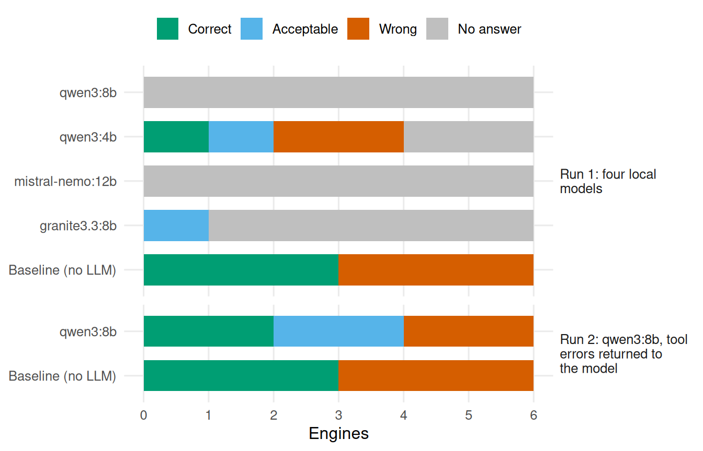
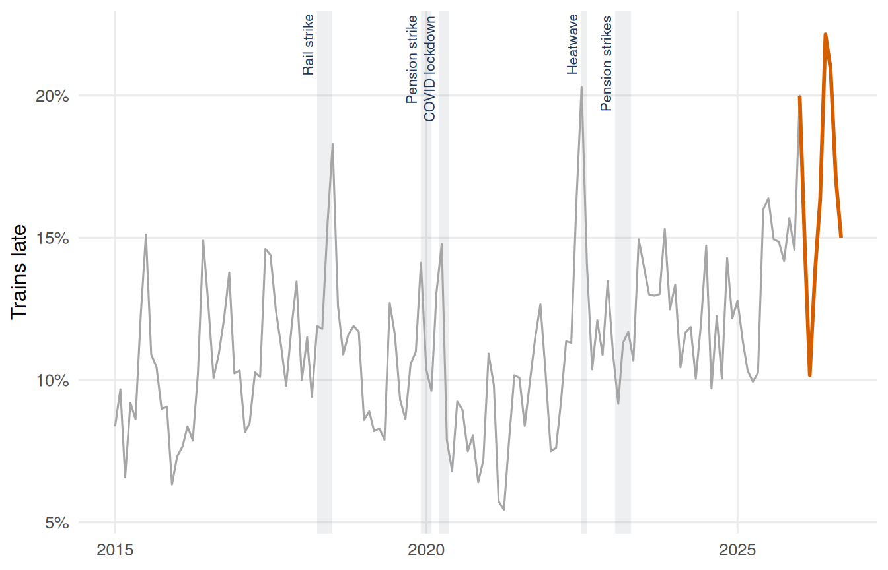
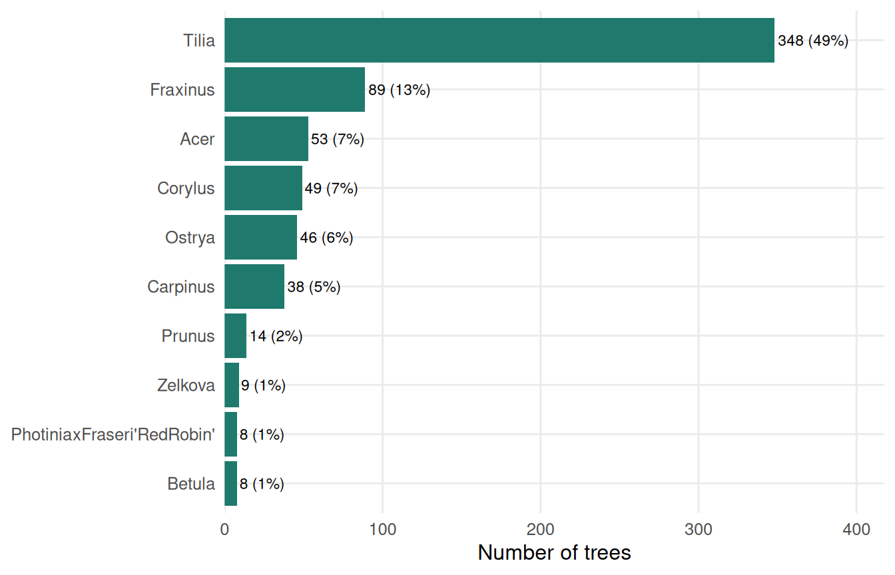

```{=html}
<section class="hero">
  <div class="hero-inner">
    <div class="hero-text">
      <span class="eyebrow"><i class="bi bi-geo-alt"></i> MSc Smart Data Science · ENSAI, France</span>
      <h1 class="hero-name">M. Faizan Chaudhary</h1>
      <p class="hero-role">Data scientist <span>·</span> ML researcher <span>·</span> Full-stack AI engineer</p>
      <p class="hero-lead">
        I build things that learn from data and the software that puts them in
        people's hands: from a peer-reviewed deep-learning model for Alzheimer's
        detection to LLM agents, RAG systems and production apps live on AWS.
      </p>
      <div class="hero-cta">
        <a class="btn-hero primary" href="#work">See my work <i class="bi bi-arrow-down"></i></a>
        <a class="btn-hero ghost" href="chapters/research.html"><i class="bi bi-journal-text"></i> Read the paper</a>
        <a class="btn-hero ghost" href="https://github.com/chaudharymfaizan78"><i class="bi bi-github"></i> GitHub</a>
      </div>
    </div>
    <div class="hero-stats">
      <div class="hs"><b>1</b><span>peer-reviewed publication</span></div>
      <div class="hs"><b>5</b><span>production systems shipped</span></div>
      <div class="hs"><b>4</b><span>data science projects</span></div>
      <div class="hs"><b>3</b><span>industry roles since 2024</span></div>
    </div>
  </div>
</section>

<section class="pillars">
  <div class="pillar">
    <div class="p-icon"><i class="bi bi-journal-richtext"></i></div>
    <h3>Research</h3>
    <p>Deep learning for medical imaging. Published in JICTRA (2026):
       CNN architecture optimisation for multiclass Alzheimer's detection.</p>
  </div>
  <div class="pillar">
    <div class="p-icon"><i class="bi bi-graph-up-arrow"></i></div>
    <h3>Data science</h3>
    <p>Reproducible analysis in R and Python: open data, statistical
       modelling, visual storytelling and LLM-agent evaluation.</p>
  </div>
  <div class="pillar">
    <div class="p-icon"><i class="bi bi-code-slash"></i></div>
    <h3>Engineering</h3>
    <p>Full-stack and AI products in production: NestJS, Next.js, React
       Native, PostgreSQL, pgvector, vLLM and AWS.</p>
  </div>
</section>

<section id="work" class="block">
  <div class="block-head">
    <span class="kicker">Selected work</span>
    <h2>Research &amp; data science</h2>
  </div>

  <a class="feature" href="chapters/research.html">
    <div class="feature-art art-research">
      <i class="bi bi-activity"></i>
      <div class="metric"><b>90.6%</b><span>accuracy</span></div>
      <div class="metric"><b>96%</b><span>specificity</span></div>
    </div>
    <div class="feature-body">
      <span class="badge-pub">Peer-reviewed · JICTRA 2026</span>
      <h3>Alzheimer's multiclass detection with optimised CNNs</h3>
      <p>Eleven CNN variants and an optimiser ablation on brain MRI, classifying
         four stages of dementia. Grew out of my IGNITE-funded final-year
         project at Bahria University.</p>
      <div class="chips"><span>Deep learning</span><span>TensorFlow</span><span>Medical imaging</span></div>
      <span class="more">Read the publication <i class="bi bi-arrow-right"></i></span>
    </div>
  </a>

  <div class="card-grid">
    <a class="wcard" href="chapters/03-agentic-phm.html">
      <div class="thumb"></div>
      <div class="wbody">
        <span class="org">with Safran · ENSAI</span>
        <h3>Agentic AI for predictive maintenance</h3>
        <p>An LLM agent that reads aircraft-engine data, calls diagnostic tools
           and recommends an action, benchmarked against a rule-based baseline.</p>
        <div class="chips"><span>LLM agents</span><span>LangChain</span><span>Evaluation</span></div>
      </div>
    </a>
    <a class="wcard" href="chapters/02-tgv-delays.html">
      <div class="thumb"></div>
      <div class="wbody">
        <span class="org">ENSAI · data visualisation</span>
        <h3>Late again? What's behind TGV delays</h3>
        <p>A data story on ten years of French high-speed rail punctuality,
           from national trends down to routes and causes.</p>
        <div class="chips"><span>Bokeh</span><span>ggplot2</span><span>Storytelling</span></div>
      </div>
    </a>
    <a class="wcard" href="chapters/01-EDA.html">
      <div class="thumb"></div>
      <div class="wbody">
        <span class="org">ENSAI · exploratory analysis</span>
        <h3>Urban trees of Saint-Germain-en-Laye</h3>
        <p>A municipal tree inventory: data quality, age structure, health
           diagnoses and an interactive map, fully reproducible from open data.</p>
        <div class="chips"><span>R</span><span>tidyverse</span><span>sf · leaflet</span></div>
      </div>
    </a>
  </div>
  <p class="see-all"><a href="chapters/04-coursework.html">Also: machine learning and R coursework <i class="bi bi-arrow-right"></i></a></p>
</section>

<section class="block">
  <div class="block-head">
    <span class="kicker">In production</span>
    <h2>Software I've built</h2>
  </div>
  <div class="dev-grid">
    <a class="dcard" href="chapters/development.html#spana-salon-booking-and-management-platform">
      <div class="d-icon c1"><i class="bi bi-calendar2-check"></i></div>
      <h3>Spana</h3>
      <p>Salon booking and management: REST API, web app and mobile app,
         bilingual English/Arabic, live on AWS.</p>
      <div class="chips"><span>NestJS</span><span>Next.js</span><span>React Native</span><span>PostgreSQL</span></div>
    </a>
    <a class="dcard" href="chapters/development.html#skinny-tax-ai-tax-assistant-with-citations">
      <div class="d-icon c2"><i class="bi bi-chat-square-quote"></i></div>
      <h3>Skinny Tax</h3>
      <p>An AI tax assistant that cites the law: RAG over federal and 50-state
         tax rules with a self-hosted LLM.</p>
      <div class="chips"><span>RAG</span><span>pgvector</span><span>vLLM</span><span>Playwright</span></div>
    </a>
    <a class="dcard" href="chapters/development.html#united-checkout-one-click-checkout-for-e-commerce">
      <div class="d-icon c3"><i class="bi bi-bag-check"></i></div>
      <h3>United Checkout</h3>
      <p>One-click checkout with OTP and map-based address verification, as a
         Shopify app and a WooCommerce plugin.</p>
      <div class="chips"><span>NestJS</span><span>MongoDB</span><span>Shopify</span><span>WordPress</span></div>
    </a>
    <a class="dcard" href="chapters/development.html#punjab-wasa-desilting-monitoring-platform">
      <div class="d-icon c4"><i class="bi bi-map"></i></div>
      <h3>Punjab WASA monitoring</h3>
      <p>A GIS monitoring platform for a government campaign across 41
         districts: field reporting, maps and KPI dashboards.</p>
      <div class="chips"><span>Leaflet</span><span>GIS</span><span>Dashboards</span></div>
    </a>
  </div>
</section>

<section class="block two-col">
  <div>
    <div class="block-head">
      <span class="kicker">Path</span>
      <h2>Experience &amp; education</h2>
    </div>
    <ol class="timeline">
      <li><span class="when">Sept 2026 – now</span>
          <b>MSc Smart Data Science</b><em>ENSAI, Rennes, France</em></li>
      <li><span class="when">Sept 2025 – now</span>
          <b>Associate Full Stack Developer</b><em>Airbridge Devs</em></li>
      <li class="hl"><span class="when">June 2026</span>
          <b>Journal article published</b><em>JICTRA, vol. 17, no. 1</em></li>
      <li><span class="when">May – Aug 2025</span>
          <b>Associate AI Engineer Intern</b><em>Symtera Technologies</em></li>
      <li><span class="when">2021 – 2025</span>
          <b>BSc Computer Science</b><em>Bahria University, Lahore</em></li>
      <li><span class="when">Jun – Jul 2024</span>
          <b>Machine Learning Intern</b><em>Remote</em></li>
    </ol>
  </div>
  <div>
    <div class="block-head">
      <span class="kicker">Toolbox</span>
      <h2>What I work with</h2>
    </div>
    <div class="toolbox">
      <h4>Data &amp; ML</h4>
      <div class="chips lg"><span>Python</span><span>R</span><span>SQL</span><span>scikit-learn</span><span>TensorFlow</span><span>PyTorch</span><span>tidyverse</span><span>LLM agents</span><span>RAG</span></div>
      <h4>Engineering</h4>
      <div class="chips lg"><span>TypeScript</span><span>NestJS</span><span>Next.js</span><span>React Native</span><span>PostgreSQL</span><span>MongoDB</span><span>pgvector</span><span>vLLM</span></div>
      <h4>Infrastructure &amp; reproducibility</h4>
      <div class="chips lg"><span>AWS</span><span>GitHub Actions</span><span>Quarto</span><span>git</span><span>uv / uvr</span></div>
    </div>
  </div>
</section>

<section class="cta-band">
  <div>
    <h2>Let's work together</h2>
    <p>Open to data science and AI internships, research collaborations and engineering projects.</p>
  </div>
  <div class="hero-cta">
    <a class="btn-hero primary" href="about.html"><i class="bi bi-person"></i> About me</a>
    <a class="btn-hero ghost" href="https://github.com/chaudharymfaizan78"><i class="bi bi-github"></i> GitHub</a>
  </div>
</section>

<p class="built-note"><i class="bi bi-gear"></i> Built with Quarto from source. Every figure is
recomputed from open data at render time, in an R environment pinned with uvr.
<a href="https://github.com/chaudharymfaizan78">How it's built</a>.</p>
```
